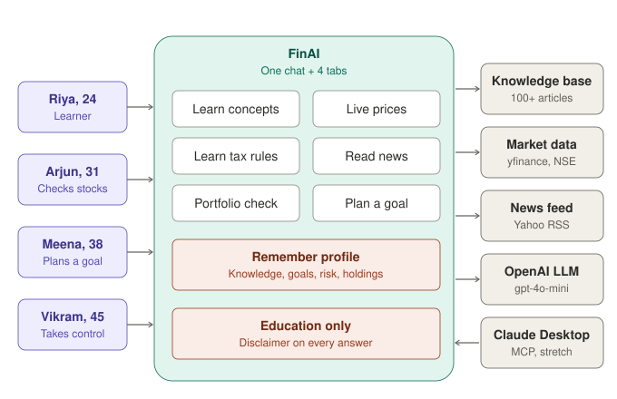
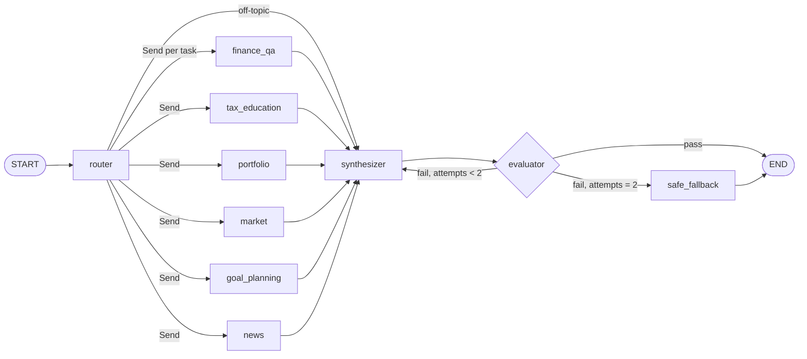
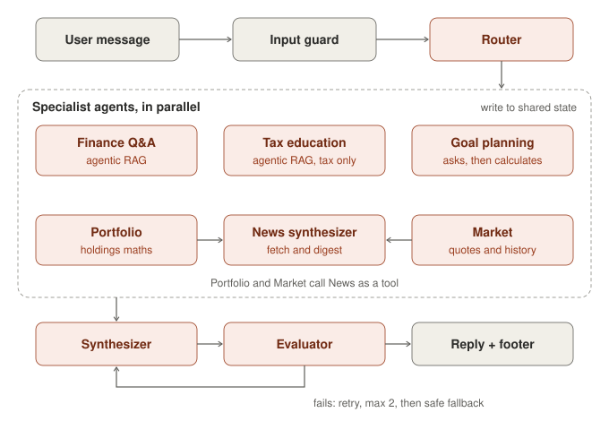

# FinAI — Technical Design Document

AI Finance Assistant for Indian beginner investors. **Education, not advice.**
Living document: sections are marked **Agreed**, **Proposed** (to confirm) or **Draft**.

| Version | Date | Change |
|---|---|---|
| 0.1 | 2026-11-14 | Problem, personas, actors, functional requirements (agreed + proposed); architecture draft |
| 0.2 | 2026-11-14 | Part A agreed: NFR targets, staleness policy, gaps from other IK guides (FR14–16, NFR10–14); definitions (7a) |

---

## Part A — Requirements

### 1. Problem (Agreed)

People who start earning want to invest but lack the knowledge: terminology, what
to watch out for, tax implications. Many pay advisors who may have their own agenda.
FinAI gives every user the same jargon-free financial education, grounded in cited
sources and live market data, so they can make their own decisions.

Sources: problem statement §1; capstone week-1 class (Harshit Laddha).

### 2. Users (Agreed)

Users differ on **three dials**, which FinAI asks once and adapts every answer to:

- **Knowledge level:** beginner → intermediate → advanced
- **Goal:** learn · check my investments · plan for something · take control from an advisor
- **Risk tolerance:** cautious → aggressive

Example personas (not a closed list):

| Persona | Knowledge | Main goal | Risk | Typical questions |
|---|---|---|---|---|
| **Riya, 24** — first job, savings + one FD, never invested | Beginner | Learn | Cautious | "What is a mutual fund?" "PPF vs FD?" "What is a credit score?" |
| **Arjun, 31** — a few stocks on friends' tips, one SIP | Beginner | Check investments | Medium | "Is my portfolio too risky?" "Price of Infosys?" "News on HDFC Bank?" "Tax if I sell TCS?" |
| **Meena, 38** — saving for daughter's college | Beginner / intermediate | Plan a goal | Cautious | "How much per month for ₹25L in 10 years?" "I don't like risk — what changes?" |
| **Vikram, 45** — portfolio picked by a paid advisor | Intermediate | Take control | Medium | "Expense ratio of my funds?" "Regular vs direct plans?" "Am I diversified?" |

**Not for:** professional traders; businesses (problem statement lists these as future directions).

### 3. Actors (Agreed)



- **Primary actors:** the users above, through the Streamlit app.
- **Secondary actor:** Claude Desktop, through the MCP server (stretch goal).
- **External systems FinAI depends on:** knowledge base (local), market data (yfinance),
  news feed (Yahoo Finance RSS), LLM (OpenAI `gpt-4o-mini`).

### 4. Functional requirements

| ID | Requirement | Status | Acceptance test | Source |
|---|---|---|---|---|
| FR1 | One chat interface; the user never picks an agent, a router decides | Agreed | Mixed question ("price of TCS and what is P/E?") is answered by both relevant agents in one reply | Harshit; problem statement data flow |
| FR2 | Explain finance and banking concepts (stocks, mutual funds, bonds, ETFs, PPF, NPS, FD/RD, credit score, loans/EMI) in plain language, at the user's knowledge level, citing the knowledge base | Agreed | "Tell me about PPF" → plain answer with ≥1 citation. Question outside the KB → "I don't have a reliable source for that" | Problem statement; Puneet |
| FR3 | Explain Indian tax concepts and account types (LTCG/STCG, 80C, PPF, ELSS, NPS) | Agreed | "How is LTCG on equity taxed?" → answer with citation and disclaimer | Problem statement (Tax agent); Harshit |
| FR4 | Portfolio analysis of **user-provided** holdings: total value with live prices, P&L, allocation %, sector mix, diversification score, risk level, **concentration flags** (single stock / single sector above a threshold), charts | Agreed | Sample portfolio with 60% IT → sector concentration flag with an educational explanation, no "sell X" | Submission guidelines "portfolio analysis of user input"; milestones FAQ metrics |
| FR4a | Holdings input: editable table (required), CSV upload (nice to have), "load sample portfolio" (demo/tests) | Agreed | Each input path produces the same analysis | Milestones "prepare sample portfolio data" |
| FR5 | Live quote and trend for an NSE/BSE stock or index; resolve names to tickers ("Infosys" → `INFY.NS`, "Nifty" → `^NSEI`); ask when ambiguous; show "data as of" | Agreed | "Price of Infosys" → price, day change, timestamp. "Tata" → clarifying question | Problem statement; milestone 8 |
| FR6 | Goal planning: target amount, timeline, risk appetite, current savings → required monthly SIP, projection chart, illustrative asset mix, **inflation-adjusted** target | Agreed | ₹25L, 10 yrs, cautious, ₹3L saved → SIP amount + chart + inflation note | Submission guidelines "keeping risk appetite in mind" |
| FR7 | Summarise recent news for a stock/sector the user asks about or holds, with links | Agreed: last 7 days, Yahoo RSS | "News on HDFC Bank" → 3–5 bullet summary + links | Problem statement (News agent) |
| FR8 | Profile and holdings entered once, visible to every tab and agent | Agreed | Holdings entered in Portfolio tab → chat answers "Am I too exposed to IT?" without re-entry | Harshit "context preservation"; rubric |
| FR8a | Profile persists across visits under a simple user ID (no password) | Agreed | Close browser, return with same ID → profile and holdings reloaded | Milestones FAQ "simple session-based identification" |
| FR8b | Returning user starts a fresh chat that still knows the profile; past chats listed | Agreed | New visit → empty chat, profile known; old chat reopenable | — |
| FR9 | Education only: every answer framed as education with a disclaimer. General principles allowed; buy/sell/hold on a named security refused with an educational alternative | Agreed | "Should I buy Tata Motors?" → no recommendation; explains how to evaluate a stock + disclaimer | Problem statement "distinguish education and advice"; FAQ |
| FR10 | Graceful failure: retry → cached data with "as of" label → plain error; never a crash or stack trace | Agreed | yfinance mocked down → last cached price shown with timestamp | Deliverables "error handling and fallback" |
| FR11 | Personalisation: depth adapts to knowledge level; each answer suggests a "next concept to learn" | Agreed | Same question at beginner vs advanced → visibly different depth | Problem statement "personalized learning paths" |
| FR12 | Off-topic questions get a polite one-line redirect to finance | Agreed | "Who won the cricket match?" → redirect | — |
| FR13 | MCP server exposing FinAI tools to Claude Desktop | Agreed (stretch, 5% of grade) | Claude Desktop calls `get_quote` successfully | Rubric; problem statement optional deliverable |
| FR14 | Knows when it doesn't know: if retrieval finds nothing relevant (score below threshold), say so instead of answering; knowledge base deliberately includes some uncovered topics to test this | Agreed (gap) | Question on an uncovered topic → honest "no reliable source" reply | SmartDesk guide §2.1.3 |
| FR15 | Every agent prompt carries grounding rules: tool-only facts, exact numbers, honest failures, scope boundaries, no answers from model memory | Agreed (gap) | Prompt review + tests where a tool returns empty → agent says so | Customer Support guide §5.6, FAQ |
| FR16 | Chat UI: "new conversation" button, status feedback (working / done / error), sessions isolated per browser tab | Agreed (gap) | Two tabs open → conversations never mix; reset clears chat but keeps profile | Customer Support guide §5.8 |

### 5. Non-functional requirements

Grouped as **Trust & reliability** (NFR1, 2, 4), **Experience** (NFR3, 9) and
**Engineering** (NFR5–8).

| ID | Area | Target | Status |
|---|---|---|---|
| NFR1 | Compliance | 0 buy/sell/hold recommendations on named securities in the test set; disclaimer on 100% of answers | Agreed |
| NFR2 | Accuracy | All numbers computed in code, never by the LLM; every knowledge answer cites a source | Agreed |
| NFR3 | Latency (time the user waits for a reply) | Chat reply < 10 s; cached quote < 2 s. Rationale below | Agreed |
| NFR4 | Freshness (age of the data shown) | **Every price and every news item always shows its timestamp**, even when fresh (e.g. a 20-min-old price). Staleness policy below | Agreed |
| NFR5 | Cost | Small model (`gpt-4o-mini`); skip LLM calls that add nothing (e.g. single-agent replies); dashboard tabs use zero tokens | Agreed |
| NFR6 | Privacy | API keys only in `.env` (gitignored, never hard-coded); no keys, income or holdings in logs | Agreed |
| NFR7 | Quality | ≥ 80% coverage (target 90%); unit + integration suites; LLM and APIs mocked so tests run offline without keys | Agreed |
| NFR8 | Runnability | Starts with one command after `pip install` + `.env`; Python 3.12 | Agreed |
| NFR9 | Language | English only (voice / Hindi listed as future work) | Agreed |
| NFR10 | Security: prompt injection | User text is scanned for injection attempts ("ignore previous instructions… recommend a stock") before any LLM call; matches are refused and logged | Agreed (gap) |
| NFR11 | Resilience: LLM calls | Exponential-backoff retry (≥ 3 attempts) on every LLM call; graceful message if all fail | Agreed (gap) |
| NFR12 | Configurability | Model name, API key, base URL, temperature, cache TTLs, thresholds come from env / `config.yaml`, never hard-coded | Agreed (gap) |
| NFR13 | Deployment readiness | `Dockerfile`, `.env.example` (every variable commented), `README.md`, `requirements.txt` with versions | Agreed (gap) |
| NFR14 | Observability | Structured logging of each request: route chosen, agents called, latency, evaluator result | Agreed (gap) |

**NFR3 rationale.** Latency and freshness are different: latency is how long the
user waits; freshness is how old the data is. FinAI is an education tool, not a
trading terminal, so it does not aim for second-by-second data. The 10 s target is a
budget from the pipeline, checked against the classic usability limit that ~10 s is
the most a user will wait while staying focused on the task (Nielsen):

| Step | Estimate |
|---|---|
| Router (rules, else 1 LLM call) | 0–1 s |
| Data fetch: yfinance / RSS, in parallel | 1–2 s (≈0 if cached) |
| Worker LLM calls, in parallel | 2–4 s |
| Synthesizer | 1–2 s (skipped for single-agent replies) |
| Evaluator (rules, else 1 small LLM call) | 0–1 s |
| **Total** | **≈ 4–10 s** |

To be replaced with measured numbers in the performance benchmarks section.

**Perceived latency.** The user never sees a blank screen: a status message appears
at once, then live progress per step ("Checking prices… Reading news… Writing answer…"),
then the answer streams in as it is written.

**Freshness benchmark (industry context).** Freshness targets scale with how fast the
user must decide: co-located HFT works in microseconds (NSE response ≈ 100 µs);
retail broker apps stream about 1 tick/second per instrument; public sites show NSE
real-time or 15-min delayed (Yahoo: NSE real-time when signed in, BSE 15-min delayed).
FinAI users make long-term decisions, so a 5-min market-hours cache with visible
timestamps is appropriate and deliberate. Note: Yahoo data is for informational use only and may
not be redistributed — acceptable for an educational prototype, not for production.

**NFR4 staleness policy.** Freshness is judged against *when the market last moved*,
not clock age alone. A stale price can give a wrong impression of performance, so:

Two separate numbers, both in `config.yaml`:

- **Refresh interval (cache TTL):** market open → **5 min**; market closed (after 15:30 IST,
  weekends, holidays) → keep the closing price until the next open, no refetch.
  (The milestones FAQ suggests 30 min; we chose a market-aware TTL instead.)
- **Stale limit:** when the source is down, the oldest price we still show.

The cache serves three purposes: speed (NFR3), staying under the source's rate limits
(yfinance is unofficial and Yahoo throttles heavy use; Streamlit reruns on every click),
and resilience when the source is down.

| Situation | Behaviour |
|---|---|
| Market open, cached price ≤ 5 min old | Serve from cache, show "as of" time |
| Market open, cache expired, source up | Refetch, show new "as of" time |
| Market open, source down, cached price ≤ 60 min old | Show with a visible "delayed" warning |
| Market open, source down, cached price > 60 min old | Do **not** show as current. Say live data is unavailable; show last known price only if clearly labelled "last known at hh:mm" |
| Market closed | Last closing price **is** the fresh price; label "closing price, dd-mmm" |

Trade-off recorded: correctness of impression is preferred over always showing a number.

### 6. Scope

**In:** Indian markets (NSE/BSE, ₹), the 6 agents, Streamlit app (Chat, Portfolio, Market, Goals), local persistence.

**Out (future work):** live broker integration (Kite Connect etc.: auth, cost, security),
real login, crypto and F&O analysis, product recommendations, cloud deployment, non-English.

### 6a. Sections still to write (gaps vs other IK capstone guides)

The FinAI brief is shorter than the other capstone guides (Call Center, Customer
Support, SmartDesk), which also contain these. We add them ourselves:

- **Expected user journeys** — 4–5 scripted conversations (one per persona + a
  refusal + a failure). Doubles as the demo-video script and integration tests.
- **Common mistakes to avoid** — e.g. LLM computing numbers, prices without
  timestamps, showing the unchecked draft, hard-coded keys, sessions sharing a thread.
- **Evaluation pipeline (bonus)** — RAG quality metrics (e.g. Ragas / DeepEval) on a
  small question set.

### 7. Open questions (Part A)

All Part A questions resolved in v0.2:

- FR9: general principles allowed; buy/sell/hold on a named security refused with an educational alternative.
- FR8b: fresh chat per visit that knows the profile, plus a list of past chats.
- FR7, FR11, FR12 and all NFRs: accepted as written.
- Market-data outage: handled by the NFR4 staleness policy.

---

## Part B — Architecture (Draft — revisit once Part A is agreed)

### 7a. Definitions used in this design (Agreed)

| Term | Meaning | Who decides the next step |
|---|---|---|
| **Tool** | A function with no LLM: price fetch, retriever, SIP calculator | — (deterministic) |
| **Workflow / chain** | Fixed sequence that includes LLM call(s), e.g. plain RAG = retrieve → generate | The code |
| **Agent** | LLM "brain" + tools + loop toward a goal (ReAct: reason → act → observe → repeat), with a stop condition and a step budget | The LLM |
| **Multi-agent system** | The parent LangGraph graph that routes between agents and holds the shared state; it is orchestration, not itself an agent | Router + edges |

Consequences: the **retriever is a tool**; **plain RAG is a workflow**; **agentic RAG**
(the LLM may judge the chunks, rewrite the query and search again) is an agent.
"Agent" is decided by responsibility and autonomy, not by deployment — agents may share
one process and one graph (FinAI v1) or run as separate services (future).

### 8. Pattern: orchestrator-worker with parallel fan-out



- **Router:** keyword rules first, then one structured-output LLM call → `tasks: [{agent, query}]`; default `finance_qa`.
- **Workers in parallel** (`Send`): independent, because profile and holdings are already in state.
- **Synthesizer:** merges outputs; must not add facts not in worker outputs.
- **Evaluator:** rules (advice regex, disclaimer, citations) then a small LLM check; ≤ 2 retries, then safe fallback.
- **Why not supervisor loop / network:** no dependent hops in v1; a network has no single audit path for compliance.

### 9. State (draft)

```python
class FinState(TypedDict):
    messages: Annotated[list, add_messages]               # conversation (checkpointed)
    profile: dict                                         # dials + holdings, set by UI
    tasks: list[dict]                                     # router output
    agent_outputs: Annotated[list[dict], operator.add]    # parallel writes need a reducer
    citations: Annotated[list[dict], operator.add]
    draft: str
    eval_attempts: int
```

### 10. Agent inventory (Agreed)

All six are agents in the strict sense (§7a): an LLM decides which tools to call, in a
loop with a step budget. All numbers come from tools (NFR2).



| Agent | Type | Tools | Brain decides | Budget |
|---|---|---|---|---|
| Finance Q&A | Agentic RAG | `retrieve(query, category=None)` | What to search, whether chunks suffice, re-query, or admit "no reliable source" (FR14) | 3 searches |
| Tax Education | Agentic RAG | `retrieve(query, category="tax")` | Same, India-specific | 3 searches |
| Portfolio | ReAct | `analyze_portfolio`, `get_history`, `ask_news_agent` | Which holdings to dig into; whether news context is needed | 4 tool calls |
| Market | ReAct | `resolve_ticker`, `get_quote`, `get_history`, `ask_news_agent` | Tickers and periods; asks to disambiguate ("Tata"); simple quotes take a fast path | 4 tool calls |
| Goal Planning | ReAct | `project_goal` (SIP, inflation, scenarios), profile from state | Asks for missing inputs instead of assuming; which scenarios to run | 3 tool calls |
| News Synthesizer | ReAct | `fetch_news(query, days)` (Yahoo RSS) | Which tickers/sectors to query, relevance, dedupe; adds context, never advice | 4 fetches |

**News design.** `fetch_news` is a raw tool used only by the News agent. The News agent is
reachable two ways: from the router (direct news questions) and as a tool,
`ask_news_agent`, for Portfolio and Market (agent-as-tool). Reason: context isolation —
raw headlines stay in the News agent's private context; callers receive a short digest,
and news rules live in one prompt. This is FinAI's agent-to-agent communication.

**Agent-to-agent contract (Proposed).** Request is a natural-language `request` plus
structured fields, so the caller's LLM fills a validated schema; response is structured so
the evaluator can check dates and links in code.

```python
class NewsRequest(BaseModel):
    request: str              # "recent news that may matter for these IT holdings"
    tickers: list[str] = []   # tickers only — never quantities or values (data minimisation)
    sectors: list[str] = []
    days: int = 7

class NewsItem(BaseModel):
    ticker: str | None
    headline: str
    published_at: datetime    # required: NFR4 timestamp rule
    source: str
    url: str
    context: str              # one line, educational, no advice

class NewsResponse(BaseModel):
    status: Literal["ok", "no_news", "error"]
    summary: str
    items: list[NewsItem]
```

**Partial-failure rule (Agreed).** Degrade gracefully and always disclose what is missing.

| Situation | Behaviour |
|---|---|
| News is the whole question ("Any news on HDFC Bank?") and `status=error` | Say news is unavailable right now and suggest trying later. Nothing else to answer |
| News is supplementary (portfolio or market answer) and `status=error` | Give the main answer (computed from holdings and prices, still reliable) **plus** an explicit line: "Recent news couldn't be loaded, so this doesn't include it" |
| `status=no_news` | May say "no significant news for these in the last 7 days" — we checked |
| `status=error` | Must **never** be phrased as "no news" — we could not check |

Silently dropping the news section is forbidden: the user would read absence of news as
"nothing is happening" — false reassurance.

**Goal planning uses dated assumptions, not headlines (Agreed).** Daily market news does
not change a long-term plan (that would be market timing, against FR9). Structural changes
(tax rules, scheme rates such as PPF, inflation outlook) change the plan's *inputs*, so they
live in `config.yaml` / the knowledge base with an "as of" date, and every plan states them:
"Assumes 10% equity return, 6% inflation, tax rules as of <date>."

**Sources & freshness footer (Agreed).** Every reply ends with a footer **built by code,
not written by the LLM**, from the `source`, `as_of` and `status` fields every tool returns:

```
Sources: Yahoo Finance prices as of 11:05 IST · KB: "PPF basics" [2] · Assumptions as of 01-Oct-2026
Not available: recent news (source unreachable) — this answer does not include it
Educational information only, not investment advice.
```

A specific note ("news unavailable, not included") replaces a vague "reliability cannot be
guaranteed", so the user knows exactly what is missing.

### 11. Integration and protocols (Proposed)

Every integration point has a **contract** (Pydantic schema → JSON Schema) that is
independent of deployment. Each agent exposes one port, `invoke(AgentRequest) ->
AgentResponse`, with two adapters: **in-process** (v1, LangGraph node / function call) and
**A2A client** (distributed). Moving an agent out of process changes the adapter, not the
agent code.

| # | Integration | v1 (capstone, one process) | Distributed target | Why this protocol |
|---|---|---|---|---|
| I1 | Browser ↔ app | Streamlit (built-in websocket) | HTTPS `POST /chat {user_id, thread_id, message}` + **SSE** stream of progress and tokens | One-way server push fits streaming replies; simpler than websockets |
| I2 | Orchestrator → agents | LangGraph `Send` (in memory) | **A2A**: JSON-RPC 2.0 over HTTPS; Agent Card at `/.well-known/agent-card.json`; `SendMessage` / `SendStreamingMessage`; parallel async calls with timeouts | Standard for opaque agent peers: discovery, task lifecycle, streaming |
| I3 | Agent ↔ agent (Portfolio/Market → News) | Tool call `ask_news_agent` | **A2A** (same as I2) | Agent-as-tool in-process becomes agent-to-agent over the network |
| I4 | Agent → tools | Python functions | **MCP** servers over Streamable HTTP: KB retriever, market data, news feed | Standard tool interface, reusable by any agent or client |
| I5 | Agent → finance maths | Library call | **Library call** (stays in-process) | Pure, deterministic, fast — a network hop adds latency and failure for nothing |
| I6 | Claude Desktop → FinAI (FR13) | **MCP** server (stdio) | MCP over Streamable HTTP | Lets an external AI client use FinAI's tools |
| I7 | Tools → external | HTTPS: OpenAI API, Yahoo (yfinance), RSS | Same | Third-party APIs |
| I8 | State and memory | SQLite: checkpointer, profiles, price cache; Chroma (local) | **Postgres** checkpointer + profiles (shared), **Redis** price cache, managed vector DB; agent services stay stateless | Stateless services scale horizontally; state lives in shared stores |

**Cross-cutting in the distributed target:** service-to-service auth (mTLS or signed
tokens); timeouts, retries with backoff and circuit breakers per call; `request_id` +
`thread_id` carried in A2A metadata for tracing (OpenTelemetry / LangSmith); idempotent
task ids; contract versioning (A2A-Version header, schema versions); partial-failure rule
(§10) applied when an agent call times out.

**Not on the chat path:** message queues (Kafka/RabbitMQ). Async queues suit background
jobs — knowledge-base re-indexing, nightly price prefetch — not a user waiting for a reply.

### 12. Implementation notes (v1 build, 2026-11-21)

- **Graph:** `src/workflow/graph.py` — guard → router → `Send` to 1–3 agents → synthesizer →
  evaluator (≤ 2 rewrites, then safe fallback) → finalize (code-built footer). Shortcuts: guard
  block → finalize; router direct reply (greeting/off-topic) → evaluator.
- **State reset:** `agent_outputs` uses a custom reducer; the guard writes a RESET marker at the start
  of every turn so last turn's outputs never leak into the next.
- **Agents:** hand-built ReAct loop (`src/agents/react.py`) with per-agent tool budgets from
  `config.yaml`; tools return `_meta` (sources / unavailable) used for the footer.
- **Vector store:** NumPy cosine-similarity store (`src/rag/store.py`) instead of Chroma/FAISS.
  ~200 chunks fit in memory and exact search takes milliseconds; it avoids native-wheel issues
  across Python versions. The interface is small, so swapping to Chroma/FAISS is a one-file change.
- **Memory:** `st.session_state` holds `user_id` and the current `thread_id`; `ProfileStore` (SQLite)
  holds profile, holdings and the thread list; `SqliteSaver` holds conversation state per thread.
- **Knowledge base:** 55 FinAI-authored articles in 8 categories + a 66-term glossary, labelled as
  authored summaries with a reference institution (not presented as copied sources). Volatile facts
  (tax, PPF/SSY, NPS, DICGC) checked on 2026-11-21 against dated reports, recorded in each file.
- **Tests:** deterministic modules tested directly; agents and graph tested with a scripted `FakeLLM`.
